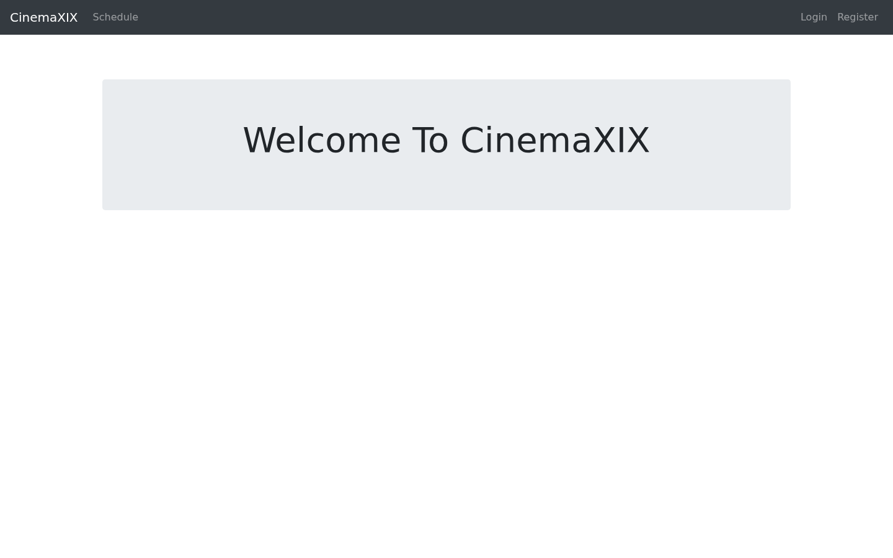
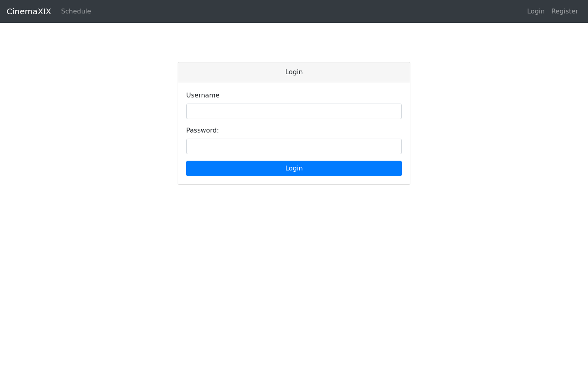
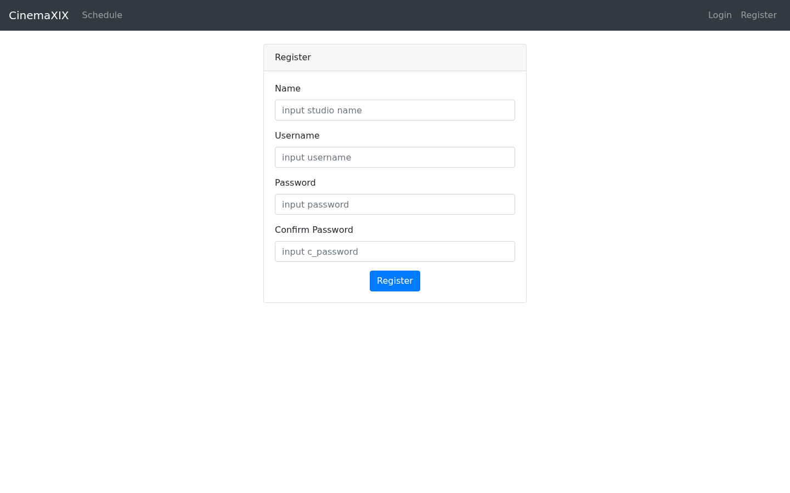
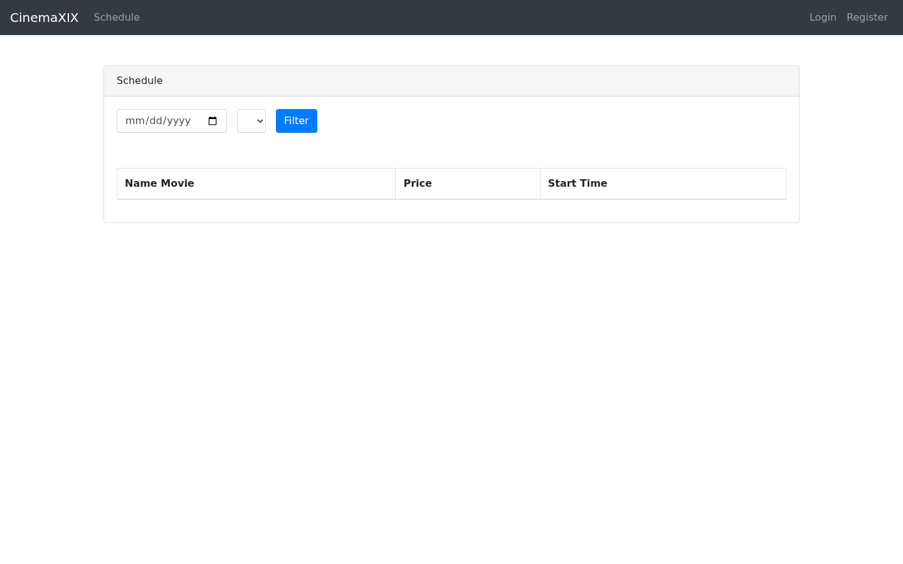

# CinemaXIX

CinemaXIX is a browser-based frontend for a cinema booking system. Staff use it to run the cinema — adding branches, studios, movies, and screening schedules — while guests use it to look up showtimes and register for an account. It keeps no data of its own: every screen reads and writes through the companion `masch-backend` API, so the cinema's data lives in one service behind a single interface.

The interface is built around a two-role split. Navigation changes with whether a login token is present in the browser: signed-in staff see the management screens, and everyone else sees the public schedule and the login and registration forms. Confirmation dialogs and labels are in Indonesian, reflecting the users it was built for.

The screens revolve around four connected records: cinema branches, the studios inside them, the movies being shown, and the schedules that pair a movie with a studio at a start time. Studios carry a basic price plus separate Friday, Saturday, and Sunday prices, and each schedule carries its own price and time window.

Aside from the login token, the browser stores no account or cinema data; each screen re-fetches what it needs from the API.



## What you can do

- Browse the public schedule of movies, prices, and start times at `/user/schedule`.
- Narrow that schedule by date and cinema branch using the date field and branch dropdown on `/user/schedule`.
- Register a new account with a name, username, password, and password confirmation at `/register`.
- Sign in with a username and password at `/login`.
- Staff add, edit, and delete cinema branches at `/branch`.
- Staff maintain studios, including basic and Friday, Saturday, and Sunday prices, at `/studio`.
- Staff manage the movie catalogue, with poster URLs shown as a live preview, at `/movie`.
- Staff create and edit screening schedules with movie and studio dropdowns and a start time at `/schedule`.

Each staff screen is a paginated list with add, edit, and delete actions; deletions ask for confirmation in Indonesian. The public schedule is the one list a guest can reach without a token.

The login and registration screens are where guests enter the system:





The public schedule is the main guest-facing screen:



That capture shows the filter and column headers but no rows. The app requests its data from an API host that is unreachable here, so the table stays empty.

## How it works

CinemaXIX is a Vue 2 single-page app whose built files are served as static assets by nginx; there is no server-side code in this repository. Routing uses history mode, so nginx rewrites unknown paths to `index.html` to keep deep links working. The build runs on Node 16 and produces a `dist/` bundle that nginx serves on port 8080.

Access is gated in the browser: the route guard checks a token kept in `localStorage` and redirects guests away from staff screens. There is no server-side check in this repository.

The API base is a hardcoded `http://127.0.0.1:8000/api/v1` string baked into the bundle at build time, not a runtime setting. All persistence and real authorization belong to the separate backend.

## Running it

These commands only start the frontend; the backend it calls is a separate service that must be running for any data to appear. Install dependencies and start the development server:

```sh
npm install
npm run serve
```

Build the production bundle into `dist/`:

```sh
npm run build
```

## Limitations

- The API base URL is a fixed literal compiled into the bundle and cannot be changed at runtime. The deployed app only works if a backend answers at `127.0.0.1:8000`; without it, every data screen — including the public schedule above — renders empty.
- Access control lives only in the browser. The route guard checks a `localStorage` token and can be bypassed by editing browser storage, so real authorization must be enforced by the backend.
- The public schedule is marked guest-only, which redirects signed-in visitors away from it instead of letting them browse while logged in.
- The HTML `<title>` is literally "vue" on every route, and the unused `Dashboard.vue` and `HelloWorld.vue` files remain in the source.
- There is no password-reset flow for accounts that cannot log in.
- The backend schema is not defined in this repository — there are no migrations or schema dumps — so the fields the screens expect are reconstructed from the code and may drift from the real API.

Developer notes, exact lockfile versions, the reconstructed entity shapes, and operational risks are in [TECHNICAL.md](TECHNICAL.md).
